pruebas de escritorio 

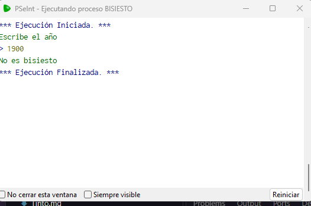
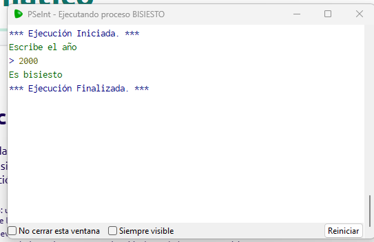
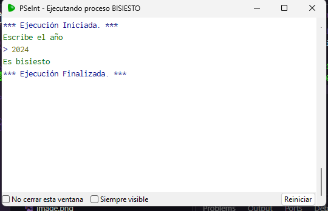
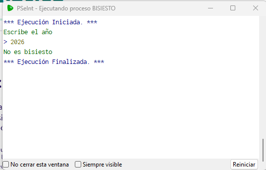

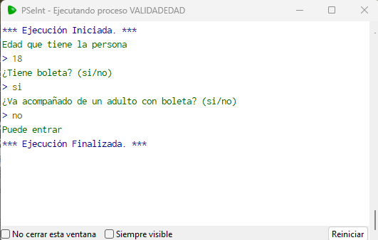
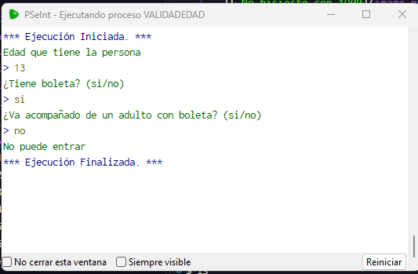
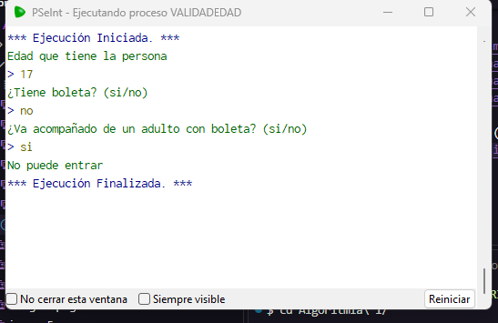
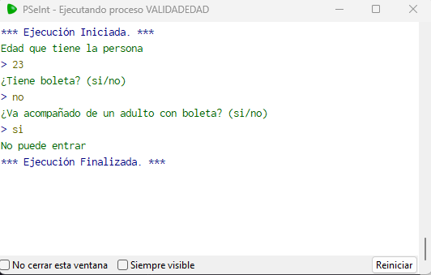

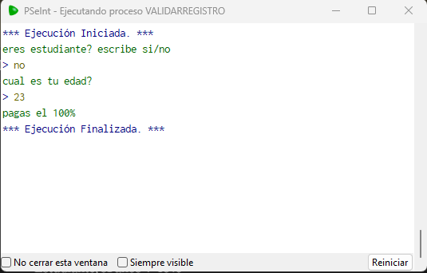
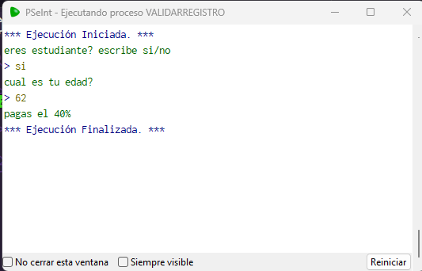
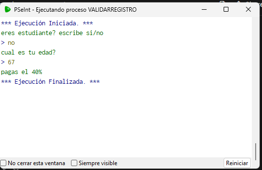
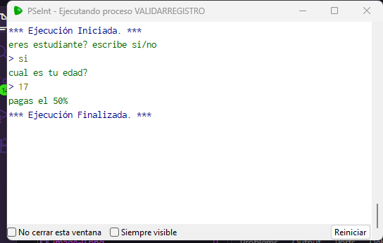

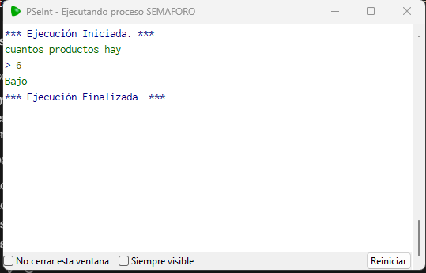
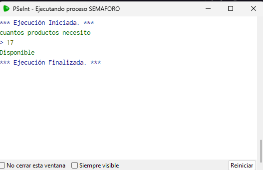
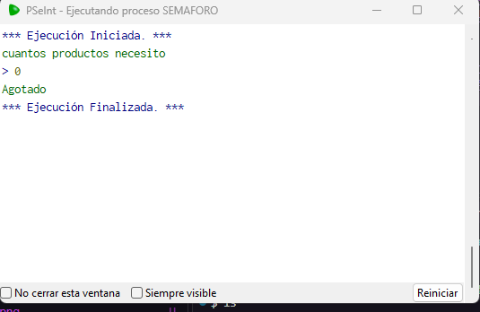
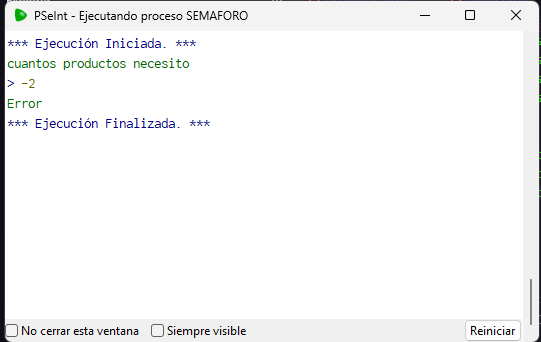

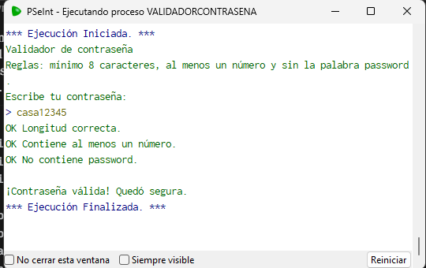
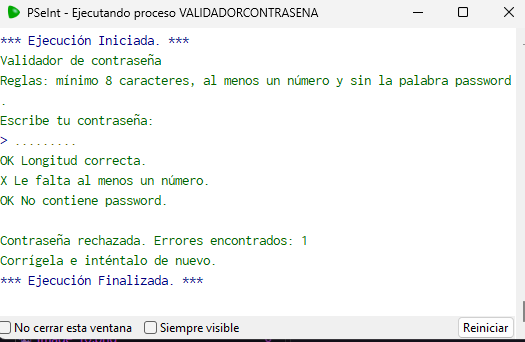
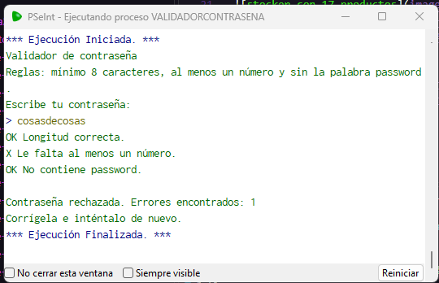
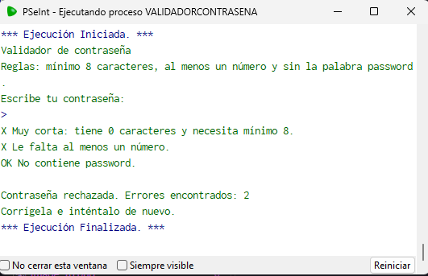

TABLAS:

prueba.

1. Acceso al evento: tabla de verdad

CONDICIONES: A = 18 años o más, B = tiene boleta, C = va con un adulto con boleta. Fórmula: (A Y B) O (NO A Y C)

A	B	C	Entra
V	V	V	Sí
V	V	F	Sí
V	F	V	No
V	F	F	No
F	V	V	Sí
F	V	F	No
F	F	V	Sí
F	F	F	No

2. Gimnasio: tabla de decisión
CONDICIONES:Estudiante	Mayor de 60	Paga
Sí	No	50 %
No	Sí	40 %
Sí	Sí	40 %
No	No	100 %

3. Contraseña: tabla de reglas

 CONDICIONES:L = tiene 8 o más caracteres, N = tiene número, P = contiene “password”. Es válida solo si L Y N Y NO P.

L	N	P	Resultado
V	V	F	Válida
F	V	F	Error: corta
V	F	F	Error: sin número
V	V	V	Error: contiene password
F	F	F	Dos errores

4. Semáforo: tabla de casos de borde
CONDICIONES:Stock	Mensaje esperado
-1	Error
0	Agotado
1	Bajo
10	Bajo
11	Disponible

