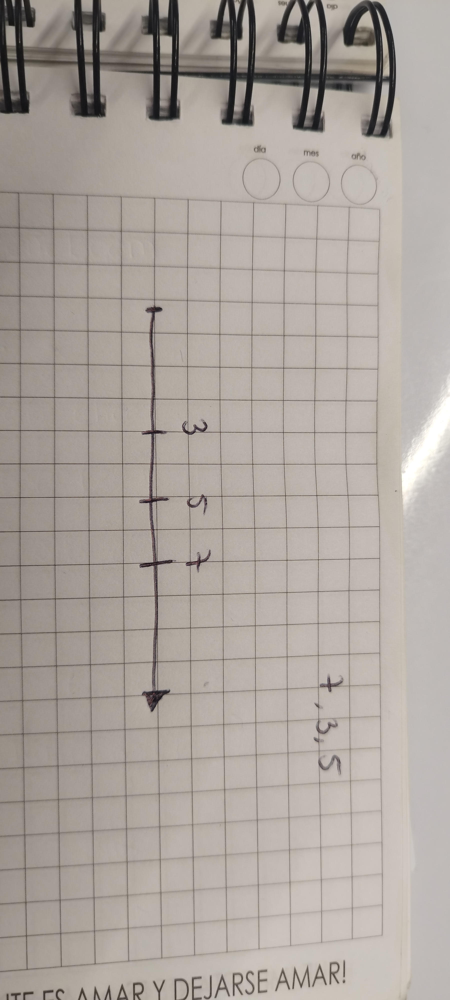

Se realizo un ejercicio en equipo de trabajo dode se debe de organizar unos números de manera que cualquier
persona lo pueda entender es por eso que optamos por una recta númerica ya que se va ubicando número por número.

